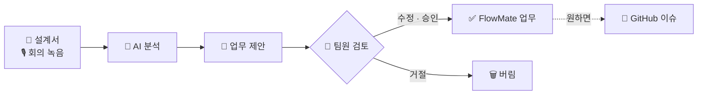
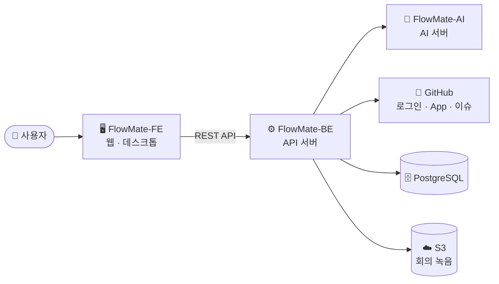

# 🌊 FlowMate

### 여러 팀 프로젝트를 한곳에서, AI와 함께

**해커톤 · 공모전 · 캡스톤 · 동아리**처럼 동시에 진행하는 팀 프로젝트를 
하나의 서비스에서 관리하는 **학생을 위한 AI 프로젝트 관리 서비스**

 

---

## 💡 FlowMate는 이런 서비스예요

> 팀 프로젝트를 하다 보면 **할 일은 메신저에, 회의 내용은 메모장에, 코드는 GitHub에** 흩어지기 쉽습니다. 
> FlowMate는 이것들을 프로젝트 하나로 모아, **지금 내가 어느 팀에서 무엇을 언제까지 해야 하는지** 바로 보여 줍니다.

<table>
<tr>
<td width="50%" valign="top">

### 📄 설계서만 올리면
AI가 팀원 각자의 **포지션과 기술 스택**에 맞춰 업무를 나누고, **담당자와 일정**까지 제안합니다.

</td>
<td width="50%" valign="top">

### 🎙️ 회의만 녹음하면
AI가 대화를 **글로 옮기고 요약**한 뒤, 회의에서 정한 **할 일을 업무로 정리**해 줍니다.

</td>
</tr>
</table>

> [!NOTE]
> AI가 제안한 내용은 **팀원이 직접 확인하고 고친 다음 승인해야** 등록됩니다. 
> 원하면 연결된 GitHub 저장소에 **이슈도 함께** 만들어집니다.

---

## 😥 이런 고민, 있지 않나요?

| | 고민 | FlowMate에서는 |
| :---: | --- | --- |
| 🔀 | 팀이 여러 개라 **어느 팀에서 뭘 맡았는지** 헷갈려요 | 모든 팀의 내 업무와 마감을 **대시보드 하나**에 모아 봐요 |
| 🧩 | 설계서를 **업무로 쪼개는 데** 시간이 오래 걸려요 | **AI가 업무 초안**을 만들고, 고쳐서 한 번에 등록해요 |
| 📝 | 회의에서 정한 일이 **회의록에만 남아요** | **AI가 할 일을 뽑아** 업무로 제안해요 |
| 🔁 | 업무 관리 도구와 **GitHub 이슈를 따로** 관리해요 | 업무를 등록할 때 **GitHub 이슈도 같이** 만들어요 |

---

## ✨ 주요 기능

<table>
<tr>
<td width="50%" valign="top">

### 👥 팀 & 프로젝트
- 활동마다 팀을 만들고 **유저 코드로 초대**
- 한 사람이 **여러 팀**에 동시에 참여
- 프로젝트별 목표 · 기간 · 설계서 · 리더
- 팀원별 **포지션과 기술 스택** 지정

</td>
<td width="50%" valign="top">

### 🐙 GitHub 연동
- GitHub 계정으로 **간편 로그인**
- 팀 Organization에 **FlowMate GitHub 앱** 설치
- 파트별 저장소 연결 (공통 · 백엔드 · 프론트엔드 · AI)
- 업무 등록과 함께 **이슈 자동 생성**

</td>
</tr>
<tr>
<td width="50%" valign="top">

### ✨ AI 업무 자동 생성
- 설계서 + 팀 구성 → **업무 초안**
- 담당자 · 기간 · 우선순위 · **예상 시간**까지
- 초안을 고쳐서 **한 번에 등록**
- 업무마다 이슈를 만들 **저장소 선택**

</td>
<td width="50%" valign="top">

### 🎙️ AI 회의록
- 앱에서 바로 **회의 녹음**
- 음성을 텍스트로 변환(**STT**)
- **요약 · 결정 사항** 정리
- 할 일 제안 → **근거 발화**와 함께 검토 → 승인

</td>
</tr>
<tr>
<td colspan="2" valign="top">

### 📋 업무 & 대시보드
**리스트 · 칸반 · 타임라인**으로 업무 보기 &nbsp;·&nbsp; 댓글로 소통 &nbsp;·&nbsp; 모든 팀의 내 업무와 **마감 D-day** &nbsp;·&nbsp; 프로젝트 **진척도 · 상태 분포 · 팀원별 업무량 · 주간 완료 추이** 차트

</td>
</tr>
</table>

---

## 🔄 AI와 함께 일하는 흐름

---

## 🏗️ 서비스 구조

<table>
<tr>
<th width="33%">🖥️ <a href="https://github.com/Team-dAIving/FlowMate-FE">FlowMate-FE</a></th>
<th width="33%">⚙️ <a href="https://github.com/Team-dAIving/FlowMate-BE">FlowMate-BE</a></th>
<th width="33%">🤖 <a href="https://github.com/Team-dAIving/FlowMate-AI">FlowMate-AI</a></th>
</tr>
<tr>
<td align="center" valign="top">웹 · 데스크톱 클라이언트</td>
<td align="center" valign="top">인증, 팀 · 프로젝트 · 업무 · 회의 API, GitHub 연동</td>
<td align="center" valign="top">설계서 분석과 업무 생성, 회의 STT와 분석</td>
</tr>
<tr>
<td align="center" valign="top">

</td>
<td align="center" valign="top">

</td>
<td align="center" valign="top">

</td>

</tr>
</table>

---

## 👩‍💻 Team dAIving

<table>
<tr>
<td align="center" width="33%">
 
<b>박소현</b> 
🖥️ Frontend 
<a href="https://github.com/dev-sohyeon">@dev-sohyeon</a>
</td>
<td align="center" width="33%">
 
<b>이다은</b> 
⚙️ Backend 
<a href="https://github.com/daeunlee1125">@daeunlee1125</a>
</td>
<td align="center" width="33%">
 
<b>김세희</b> 
🤖 AI 
<a href="https://github.com/SEI135">@SEI135</a>
</td>
</tr>
</table>
